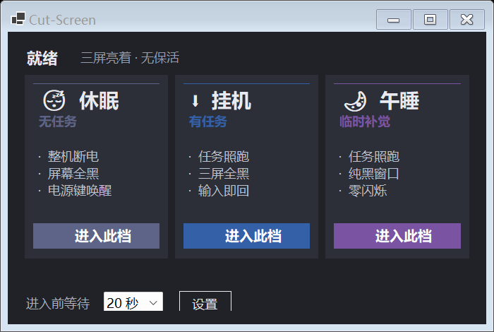
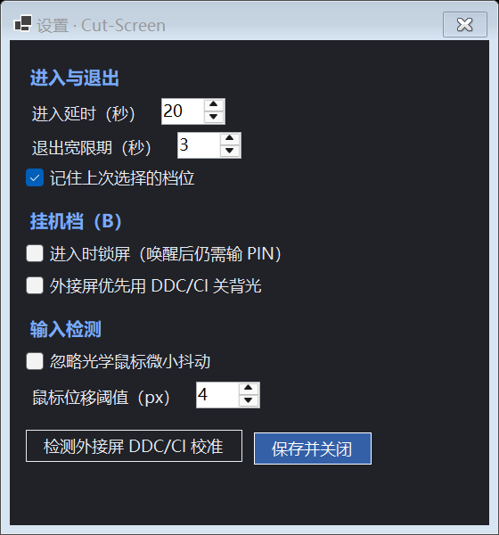

# Cut-Screen

> Cut-Screen 是一个给宿舍里用笔记本外接多屏的人用的 Windows 托盘工具，用于「灭屏但让电脑继续跑任务」并免掉合盖。



Windows 电源菜单里没有「只关显示器、系统照常运行」这个动作：睡眠会停掉下载和长任务，锁定到点照样睡，「X 分钟后关闭显示器」又没有按钮可以立即触发。Cut-Screen 把这个被藏起来的动作做成三个可点的档位。

[](https://github.com/AnAcretiondisk9986/Cut-Screen4nap/actions/workflows/ci.yml)
[](LICENSE)

## 特性

- 三档切换：休眠、挂机、午睡，按「有没有任务」选
- 只保系统不睡，绝不保屏幕不亮
- 移动鼠标或按任意键即退出，设置自动还原
- 显示器运行时动态枚举，换地点不用改配置
- 不改电源计划，靠进程级句柄与重暗定时器控屏
- 崩溃后自恢复，强杀进程也能还原残留设置

## 安装

需要 Windows 10/11 x64 与 **.NET 10 SDK ≥ 10.0.100**（含 Desktop Runtime）。

```powershell
git clone https://github.com/AnAcretiondisk9986/Cut-Screen4nap.git
cd Cut-Screen4nap
dotnet build -c Release
.\bin\Release\net10.0-windows\CutScreen.exe
```

<details>
<summary>只装运行时、不装 SDK 时的启动方式</summary>

复制 `bin/Release/net10.0-windows/` 下全部四个文件到任意目录，双击 `CutScreen.exe`：

```text
CutScreen.exe  CutScreen.dll  CutScreen.runtimeconfig.json  CutScreen.deps.json
```

单独拿 exe 会报「You must install .NET Desktop Runtime」。需先安装 [.NET 10 Desktop Runtime](https://dotnet.microsoft.com/download/dotnet/10.0)。
</details>

## 快速开始

收尾操作做完、放好键鼠之后，在主界面点一档。默认有 20 秒可取消倒计时，够你躺下。

```text
1. 双击 CutScreen.exe            → 托盘出现图标，主窗口显示三张卡片
2. 点「午睡」→ 进入此档          → 状态行变为「即将进入【午睡】」
3. 20 秒后                        → 主窗口自动隐藏，屏幕被纯黑窗口盖住
4. 移动鼠标或按任意键            → 黑窗口撤除，主窗口自动回来
```

自检（只读，不会关屏、锁屏或休眠）：

```powershell
dotnet run -c Release -p:DefineConstants=SELFTEST -p:OutputType=Exe
```

预期输出：

```text
Cut-Screen 环境自检（不会改变屏幕/电源状态）

  [OK]   [1] 显示器枚举 → 2 块可见屏幕
  [OK]   [2] 当前活动电源方案 → 381b4222-...
  [OK]   [3] 关闭显示器超时(AC) → 0 秒
  [OK]   [4] 空闲输入时钟 → tick=200560765，单调=True
  [OK]   [5] DDC/CI 物理显示器探测(不写 VCP) → 1 台（0 台也正常，会走纯 DPMS）
  [OK]   [6] 休眠可用性 → HibernateEnabled=0
  [OK]   [7] Config 往返 → 一致 (37)
  [OK]   [8] Snapshot 落盘→Recover→清空 → Recover=True，残留=无

自检完成：未调用任何会关屏 / 锁屏 / 休眠的 API。
```

屏幕数量与具体数值随机器变化，只要每项都是 `[OK]` 即可。

## 三档怎么选

| | 休眠（无任务） | 挂机（有任务） | 午睡（临时补觉） |
|---|---|---|---|
| 下载 / Agent | 停，状态写盘保留 | 照常跑 | 照常跑 |
| 屏幕 | 全黑 | 真黑 | 深灰（IPS 透灰） |
| 恢复 | 按电源键，几十秒 | 任意输入，秒回 | 任意输入，秒回且零闪烁 |
| 改电源计划 | 否 | 否 | 否 |

- 有任务要跑又想彻底黑 → 挂机
- 只补个觉、能接受深灰 → 午睡（零硬件依赖，最稳）
- 夜里没任务 → 休眠（断电后想合盖也行，但只能电源键唤醒）



## 文档

- 完整使用指南与原理：[docs/guide.md](docs/guide.md)
- 架构与代码结构：[docs/architecture.md](docs/architecture.md)
- 命令与配置项速查：[docs/configuration.md](docs/configuration.md)

## 已知边界

- 屏幕灭了，显示器待机灯、键盘背光、RGB 仍在，软件收不掉。
- 挂机档默认不锁屏，靠「键鼠已放置」的物理隔离兜底；在意室友动鼠标可在设置里开启锁屏。
- 挂机档的 DDC/CI 默认关闭，`VCP 0xD6` 深睡可能导致背光叫不醒，先跑一次校准再开。

## 贡献

提交前请阅读 [CONTRIBUTING.md](CONTRIBUTING.md)。最短流程：fork → 分支 → `dotnet build -c Release` → PR。

## License

[MIT](LICENSE)
